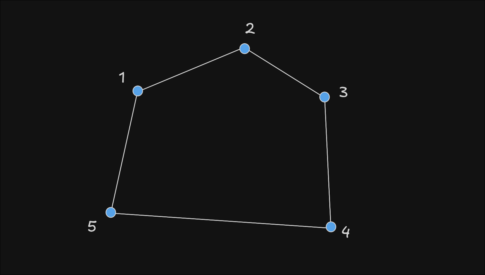
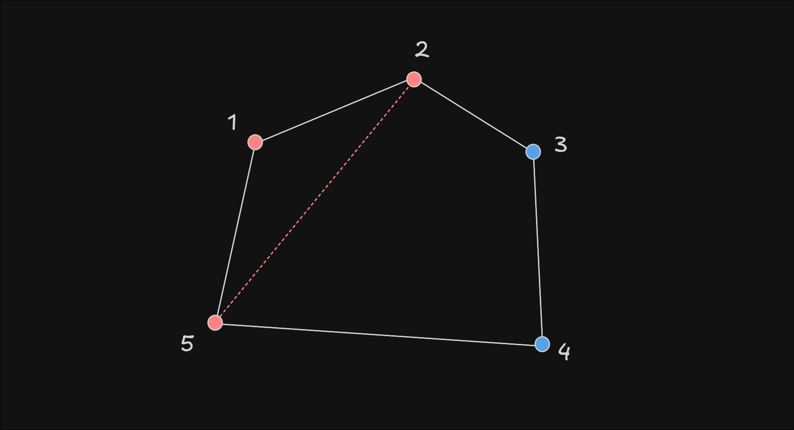
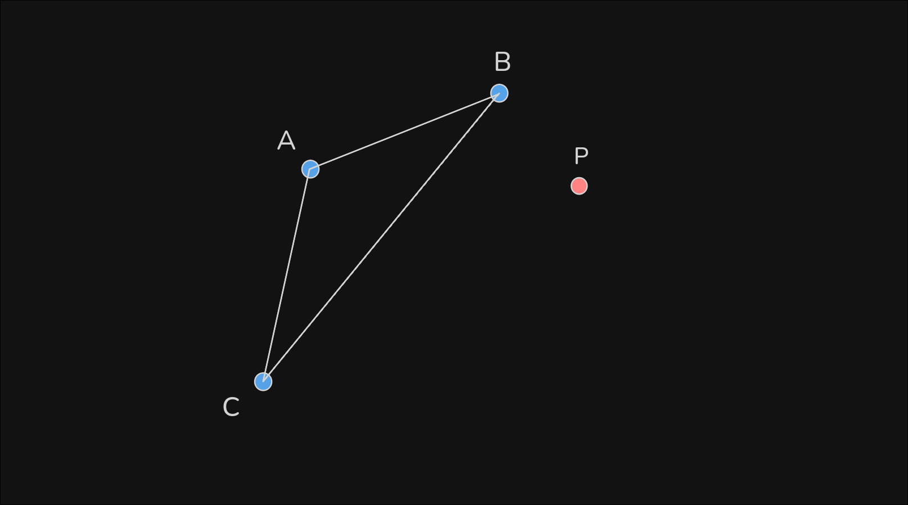
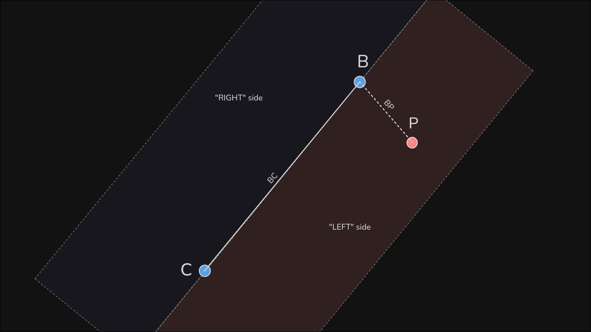
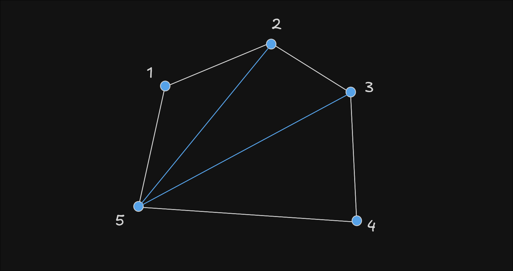
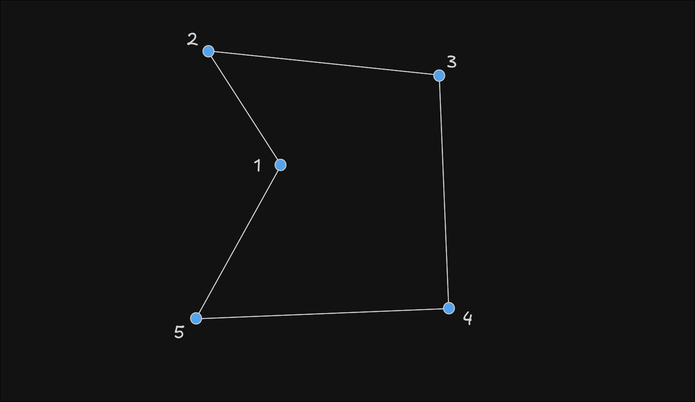
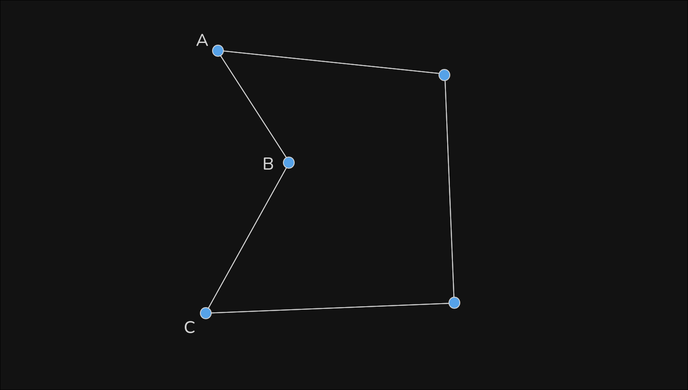
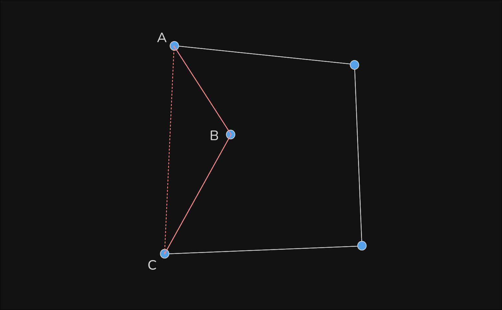
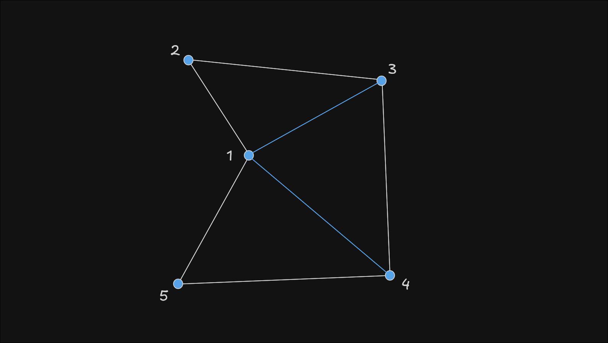

# Polygon Triangulation

## Introduction

In this article we will talk about polygon triangulation (splitting a polygon into triangles), using the [Ear clipping Method](https://en.wikipedia.org/wiki/Polygon_triangulation#Ear_clipping_method). I will include what I think is an "intuitive" (for me at least) explanation of all the parts of the algorithm, as well as visual examples, and an interactive demo written in __Odin__ and __raylib__ to prove that it works.

Quick note about this method: this is not going to be the __fastest__ way to split a polygon up into triangles, however, it is one of the most intuitive ways that I found (and it's still plenty fast). This algorithm works for __convex__ and __concave__ polygons, but it doesn't work for [complex polygons](https://en.wikipedia.org/wiki/Complex_polygon) — namely polygons that have intersecting edges, or polygons that contain holes.

The result of our algorithm will be a list of __(n-2)__ triangles, where __n__ is the number of total vertices in our polygon.

If you'd rather get straight to the code, you can find my demo here: [https://github.com/cristicismas/polygon-triangulation-demo/](https://github.com/cristicismas/polygon-triangulation-demo/).

Let's get started!

## Ear clipping method

The whole algorithm is based on __clipping / cutting off__ the "ears" of the polygon, until only one triangle remains. An "ear" is defined as a triangle that could be formed by connecting 2 non-connected vertices, such that the resulting triangle is __inside__ our polygon, and none of the other vertices are inside the triangle. Let's start with a simple case for this algorithm.

Below I drew a simple convex polygon, and I numbered each vertex so we can easily refer to them.



Inside this polygon, we can cut off multiple ears, but let's start, in a __clockwise-winding order__, from the number 1.

> Important! The winding order of the polygon matters a lot for this algorithm! It works with both clockwise winding order, and counter clockwise winding order, but you need to know which one the polygon uses! For this article we will exclusively use clockwise winding order.

### Algorithm steps

The __ear clipping method__ follows a simple set of steps:

1. For each vertex, determine if the __inside angle__ formed by the vertex neighbours is __convex__ or __concave__. Since we are dealing with a fully convex polygon right now we don't care about this step (we will care later for another polygon).
2. If we were to form a triangle using the vertex's neighbours, would any other vertex of our polygon be inside this triangle? If the answer is yes, then we skip the vertex, because the triangle would not be an "ear".
3. Form a triangle between the current vertex, and its neighbours.
4. Repeat from step 1 until we are left with 3 vertices in our checklist.
5. Form the last triangle between the last 3 vertices.

So, in our simple convex polygon, we start from vertex number 1, and check if we can form a triangle between its neighbouring vertices:



Assuming we know that this polygon is convex, let's skip step 1 for now to keep it simple.

### Checking if a point is inside a triangle

The next step is to figure out if any other vertex of the polygon is inside the formed triangle. One of the ways to figure this out, is to check if a given point (vector), "sits" on the same side of all the triangle edges.

For example, if a point is on the "right" side of all the edge vectors, it means that the point is inside the triangle, otherwise it means that the point is outside. Which side the point sits on can be easily computed by calculating the cross-product between the __edge vector__ and the __vertex-to-point vector__.

Let me illustrate this to make it clear. Let's define a triangle formed by vectors A, B, and C, and an arbitrary point P that is either outside or inside the triangle.



The first step is to form the edge vectors of our triangle. This is simply done by subtracting the vectors in a __clockwise__ order. The order you subtract in is important! You can also do it in a __counter-clockwise__ order, what is important is that the order is consistent across all edges, otherwise our cross product check will fail later!

The resulting edge vectors will be called AB, BC, and CA.

```
AB = B - A
BC = C - B
CA = A - C
```

Then, from each vertex of the triangle, we compute the vector to the point as such:

```
AP = P - A
BP = P - B
CP = P - C
```

We compute these vectors so we can find the cross product between the edge vectors, and the vertex-to-point vectors, which will tell us which side the point is sitting on.

Now we need to compute 3 cross products, and check that they all have the same sign. Whether the sign of the cross products is positive or negative is not important, the only thing we care about is that the sign of all 3 is the same. You will either get negative or positive cross products from the calculations depending on whether the y-axis in your coordinate system is positive up, or positive down, and depending on your winding order. Again, we don't care about this, except to make sure that the sign of the cross products is the same.

```
firstCross = AB x AP
secondCross = BC x BP
thirdCross = CA x CP

if firstCross > 0 && secondCross > 0 && thirdCross > 0 {
	// point is inside the triangle!
} else if firstCross < 0 && secondCross < 0 && thirdCross < 0 {
	// point is inside the triangle!
} else {
	// point is OUTSIDE the triangle!
}
```

Taking into consideration out previous illustration, we can find that the point P is outside the triangle, because firstCross and thirdCross both have the same sign, however, secondCross has a different sign, because the point sits on a different side of the edge. In my coordinate system, where the y axis is positive in the down direction, the point P sits on the "left" side of the edge, which may be confusing since in the next illustration it is on the right side of the screen.



However, the side that the point sits on is dependent on the order of the subtractions when we formed the edge vectors. That's why I said it's important for them to be consistent.

if the edge vector was __CB__ instead of __BC__, the sign of the cross product would be inverted, and the point would sit on the "right" side of the edge.

### Forming a triangle

Now that we have a way to check if a point is inside the triangle, let's go back to our polygon.


After we have determined that none of the other vertices of our polygon are inside the triangle 1-2-5, we can move on to the next step, which is forming the triangle. In my [demo](https://github.com/cristicismas/polygon-triangulation-demo/blob/master/main.odin#L90), I'm keeping a separate list of the triangles, to which I keep adding until the algorithm is done. In the main loop, if I determine that a triangle can indeed be formed without issue, I build it from the previous vertex in the shape, the current vertex and the next vertex:

```
triangle := Triangle{prev, current, next}
```

After a triangle is formed and added to the triangles list, we need to remove the current vertex from our checklist, break out of the loop and restart from the beginning. The reason why we break the loop and restart, is because we are removing an element of the currently looping array, so the program will crash because eventually we will hit a segmentation fault. Another reason is that, after forming the triangle, new possibilities may have emerged to form other triangles that we may have previously dismissed.

Repeating the loop until only 3 vertices remain, we will finally have a triangulation of our polygon:



As you can see, the result of our 5 vertex polygon triangulation is a shape made out of 3 triangles. To check that your algorithm works correctly, you can add an assert in your program that the resulting number of triangles is always (n-2), where n is the number of vertices you have.

Now, let's move on to concave polygons.

### Triangulating concave polygons

In our previous shape, we have dismissed the first step of the algorithm, which is checking if a given angle is convex or concave. Let's attempt to solve this step now.

I have now constructed a 5-vertex concave polygon as such:



Let's focus on the angle that we can see is concave in the illustration, namely the angle formed by vectors 1-2 and 1-5. Now let's rename the vertices in question using letters so we can refer to them more easily.



What we care about specifically in this case is the angle formed by vectors BA and BC. We need to find out if this angle (the one that is inside the polygon, not outside of it), is more than 180 degrees, or less than 180 degrees.

As it turns out, the cross product comes to our rescue again. By computing the cross product between vectors BA and BC, we will get a result that is either less than, or more than 0 (assuming the vectors are not collinear). Now, the sign will again vary depending on your coordinate system and the winding order of your polygon. Assuming that the y-axis is positive in the down direction, and the polygon has clockwise-winding, if the cross product has a positive sign, our angle is reflex — more than 180 degrees.

What this means for our algorithm, is that we can't form a triangle using the current vertices. Doing so will result in a triangle outside of our shape, which is clearly the wrong thing to do.



So, what do we do in this case? We simply skip the current vertex and head to the next one. Eventually we will be able to form different triangles such that we are __only__ left with triangles.

The rest of the steps in our algorithm remain unchanged. This is the only exception we need to handle for concave polygons. Since the rest of the angles will will form are all acute (less than 180 degrees), the rest of the triangulation is very simple.



## Conclusion

Hopefully now you have gained an intuitive understanding of how to triangulate any given polygon. This algorithm can be used for passing polygons to the GPU in the form of triangles, as a step for convex decomposition, as a step for splitting up a navmesh for complex pathfinding, and many other use-cases. Like I said in the beginning, this may not be the fastest way to split a polygon up into triangles, however, it is a very intuitive way.

You may want to check out my demo, as an interactive experience where you can play around with the vertices of a polygon and check how it works (and breaks!) under certain conditions: [https://github.com/cristicismas/polygon-triangulation-demo/](https://github.com/cristicismas/polygon-triangulation-demo/).

## Reference

The youtube channel [Two-Bit Coding](https://www.youtube.com/@two-bitcoding8018) provides an excellent explanation in [video-essay form](https://www.youtube.com/watch?v=QAdfkylpYwc) of the same ear clipping method. This has served as my inspiration for writing this article.


## Thanks for reading!

If this article helped you, feel free to share it with others! If you have any feedback, or something wasn't clear enough, I'd love to hear about it, so please send me an email at [cristicismas@pm.me](mailto:cristicismas@pm.me).

